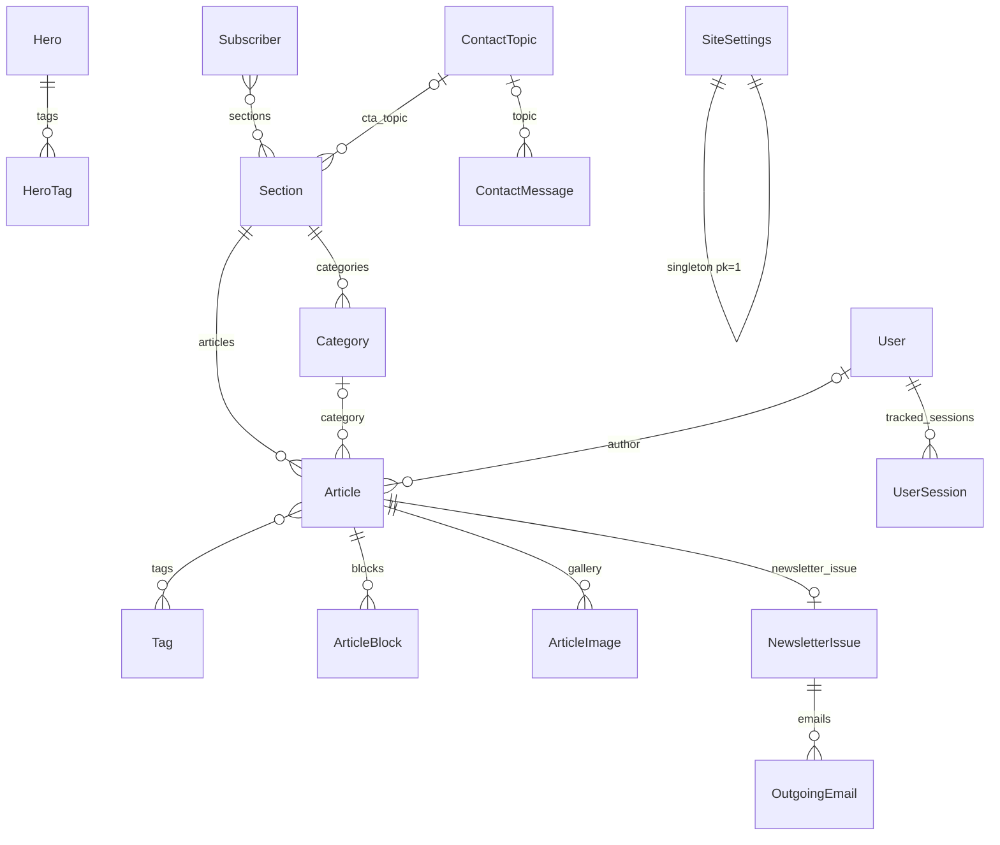

# Modello dati

## Diagramma ER

Convenzioni: ogni modello mostrato nell'admin ha `verbose_name` e `help_text` in azero.
I modelli ordinabili hanno `order` (PositiveInteger, indicizzato), gestito con il drag & drop di Unfold.

---

## app `core`

### SiteSettings (singleton, `pk=1`)
`save()` forza `pk=1`, `delete()` non fa nulla, `SiteSettings.load()` = `get_or_create(pk=1)`.
L'admin apre direttamente il form di modifica (niente lista, niente aggiunta o cancellazione).

| Campo | Tipo | Note |
|---|---|---|
| site_name | Char 80 | testo del logo, `<title>` di default |
| logo, favicon | File | opzionali |
| font_preset | Char choices `FONT_PRESETS` | default `inter_fraunces` |
| color_preset | Char choices `COLOR_PRESETS` | default `green` |
| nav_cta_label | Char | bottone del menu («Əlaqə») |
| contact_title, contact_text, contact_email | | sezione contatti |
| notification_email | Email | dove arrivano i messaggi del form |
| show_contact_section, show_subscribe_box | Bool | |
| subscribe_title, subscribe_text | Char | |
| footer_text | Char | |
| seo_title, seo_description, og_image | | meta di default; og_image → WebP |
| analytics_snippet | Text | iniettato nel `<head>`, visibile **solo al superuser** |

Proprietà: `fonts`, `colors` (dict dai preset).

### Hero
Più versioni; **una sola attiva**.

| Campo | Tipo | Note |
|---|---|---|
| name | Char 80 | nome interno della versione |
| is_active | Bool | `UniqueConstraint(fields=[is_active], condition=Q(is_active=True))` |
| title_line_1 | Char 120 | riga in grassetto |
| title_line_2 | Char 160 | riga in corsivo serif, colore accent |
| intro_text | Text | |
| portrait, portrait_alt | Image, Char | WebP |
| portrait_position | `right` / `left` / `none` | |
| font_preset | choices, vuoto = quello del sito | |
| show_section_cards | Bool | card delle sezioni sotto l'hero |
| updated_at | auto_now | |

`save()`: in una transazione, se `is_active` disattiva prima gli altri (`update`), poi salva.
Quindi il vincolo parziale non scatta mai in uso normale ed è solo una rete di sicurezza.

**HeroTag**: `hero` FK CASCADE, `label`, `is_visible`, `order`.

### SocialLink
`name`, `icon` (choices: instagram, facebook, linkedin, youtube, telegram, x, tiktok, website), `url`, `is_visible`, `order`.

### ContactTopic
`name`, `is_visible` (mostrato nel menu a tendina), `order`. Usato anche da `Section.cta_topic`.

### ContactMessage
| Campo | Note |
|---|---|
| name, email, phone (opz.), topic FK SET_NULL, message | dal form pubblico |
| created_at | indicizzato |
| is_read | impostato automaticamente all'apertura nell'admin |
| is_archived | i messaggi archiviati sono nascosti dalla lista finché non si filtra su «Arxivdə» |
| ip_address | da `X-Real-IP` |

### UserSession
Tracciamento delle sessioni per la revoca (vedi [AUTH.md](AUTH.md#sessioni-e-revoca-logout-immediato)).
`user` FK CASCADE, `session_key` unique (= `django_session.session_key`), `ip_address`, `user_agent`,
`created_at`, `last_seen_at`; proprietà `device` («Mac · Chrome»). Le righe di sessioni scadute vengono
eliminate all'apertura della lista nell'admin (`purge_stale`).

---

## app `content`

### Section
| Campo | Tipo | Note |
|---|---|---|
| title | Char 80 | |
| slug | Slug unique | auto da `az_slugify(title)`; vietati i `RESERVED_SLUGS` |
| number_label | Char 6 | «01»; se vuoto, numerazione automatica nel template |
| card_subtitle | Char 120 | testo della card nell'hero |
| intro_text | Text | |
| layout | `featured_list` / `card_grid` / `table_archive` / `dark_media` | sceglie il template |
| theme | `light` / `gray` / `dark` | sfondo |
| order | PositiveInt | ordine in home e nel menu |
| is_visible | Bool | nasconde la sezione **e tutti i suoi articoli** |
| show_in_nav, show_in_hero_cards, highlight_card | Bool | |
| items_on_homepage | 1–12 | default 4 |
| see_all_label | Char | «Hamısı →» |
| show_category_filter | Bool | pulsanti filtro in home (tabella) |
| cta_label, cta_topic FK, cta_url | | bottone extra; `cta_href` = `cta_url` (solo schemi sicuri) oppure `/?movzu=<topic>#elaqe` |
| seo_title, seo_description | | |

### Category («Növ»)
Sotto-tipo **all'interno di una sezione** (Ədəbiyyat: Hekayə/Şeir/Esse; Media arxivi: Qəzet/Televiziya/Müsahibə …).
Serve per l'etichetta sulle card, la colonna «Növ» della tabella e i filtri.
`section` FK CASCADE, `name`, `slug` (auto), `order`. `UniqueConstraint(section, slug)`.
`Article.clean()` controlla che la categoria appartenga alla sezione dell'articolo.

### Tag
`name` unique, `slug` unique auto. M2M con Article (etichette trasversali, opzionali).

### Article
| Campo | Tipo | Note |
|---|---|---|
| section | FK PROTECT | non si può eliminare una sezione con articoli |
| category | FK SET_NULL | |
| tags | M2M | autocomplete |
| authorship | `own` / `interview` / `about` / `mention`, indicizzato | **chi ha scritto**: lei; sue parole raccolte da altri (intervista, intervento); altri su di lei; solo citata (nome in un elenco, breve nota). Default `own` |
| title | Char 200 | |
| slug | Slug 120 | auto; unico **per sezione** (`UniqueConstraint(section, slug)`) |
| excerpt | Text ≤400 | card e liste, testo delle e-mail |
| cover_image, cover_alt, show_cover | | WebP |
| status | `draft` / `published` | |
| publish_at | DateTime, indicizzato | futuro = programmato |
| is_featured | Bool | primo in home nella sua sezione (card grande in `featured_list`) |
| is_pinned | Bool | prima degli altri nella pagina sezione e in home |
| link_mode | `page` / `external` / `pdf` | cosa apre il clic sulla card (`href`) |
| external_url, pdf_file | | obbligatori in base a `link_mode` (`clean()`) |
| source_name, source_year | | colonne «Media» / «İl» del media archive |
| original_author | Char 120 | giornalista che firma il pezzo; vietato con `authorship=own` (`clean()`) |
| audio_file | File mp3/m4a/ogg/wav | bottone «Dinlə» |
| video_url, video_duration | | card video nel layout `dark_media`; validato come URL YouTube |
| seo_title, seo_description | | |
| author | FK User SET_NULL, non editabile | impostato in `save_model` |
| created_at, updated_at | | |

Indice: `(section, status, publish_at)`.
QuerySet: `public()`, `visible_for(user)`, `homepage_order()`, `listing_order()`.
Proprietà: `is_own`, `authorship_label` («Müsahibə» / «Haqqımda» / «Adım çəkilir», vuota per i suoi testi), `href`, `opens_new_tab`, `is_public`, `is_scheduled`, `youtube_id`, `reading_minutes` (200 parole/min sui blocchi visibili).

### ArticleBlock
Vedi la tabella dei tipi in [ARCHITECTURE.md §5](ARCHITECTURE.md#5-contenuto-a-blocchi).

| Campo | Tipo |
|---|---|
| article | FK CASCADE (`related_name="blocks"`) |
| type | Char choices |
| order | PositiveInt |
| is_visible | Bool |
| heading | Char 200 |
| text | Text (HTML sanitizzato con nh3 in `save()`) |
| image, image_alt, caption | Image (WebP), Char, Char |
| image_position | `left` / `right` / `center` / `full` |
| image_width | 20–100 (≤70 per `text_image`) |
| text_wrap | Bool |
| quote_author | Char |
| youtube_url | URL (validato) |
| file | File pdf/mp3/m4a/ogg/wav |
| button_label, button_url | Char (schemi URL sicuri) |

### ArticleImage
Galleria dell'articolo: `article` FK CASCADE (`gallery`), `image`, `alt`, `caption`, `order`.
Mostrata dove l'articolo contiene un blocco `gallery`.

---

## app `newsletter`

### Subscriber
| Campo | Note |
|---|---|
| email | unique |
| name | opzionale |
| sections | M2M Section; **vuoto = tutte le sezioni** |
| token | UUID unique: link di conferma, gestione, disiscrizione |
| is_confirmed, confirmed_at | double opt-in |
| created_at, unsubscribed_at | `unsubscribed_at` valorizzato = disiscritto (la riga resta, per lo storico) |

QuerySet: `active()` (confermato e non disiscritto), `interested_in(section)`.

### NewsletterIssue
`article` **OneToOne** → un articolo si può inviare una volta sola (vincolo a livello di DB).
`subject`, `created_at`, `created_by`, `recipients_count`; proprietà `sent_count`.

### OutgoingEmail (coda)
`issue` FK nullable (null = e-mail transazionale: conferma o notifica contatti), `to_email`, `reply_to`,
`subject`, `body_text`, `body_html`, `unsubscribe_url` (header `List-Unsubscribe`),
`status` (`pending` / `sent` / `failed`), `attempts` (max 3), `last_error`, `created_at`, `sent_at`.

---

## Dati iniziali

- Migrazione `content.0002_seed_initial_content` (generica): `SiteSettings` pk=1 e gruppo «Redaktor»
  con i permessi di `core/permissions.py`.
- Struttura del sito (sezioni con i loro tipi, hero, argomenti di contatto, social, impostazioni):
  dal seed dell'istanza, `manage.py setup_site` → `instance/seed.json`. Formato documentato in
  `content/management/commands/import_content.py`; esempio completo in `instance.example/seed.json`.
- Contenuti: `manage.py import_content instance/content/<file>.json`, con i testi in `texts/<slug>.md`.
